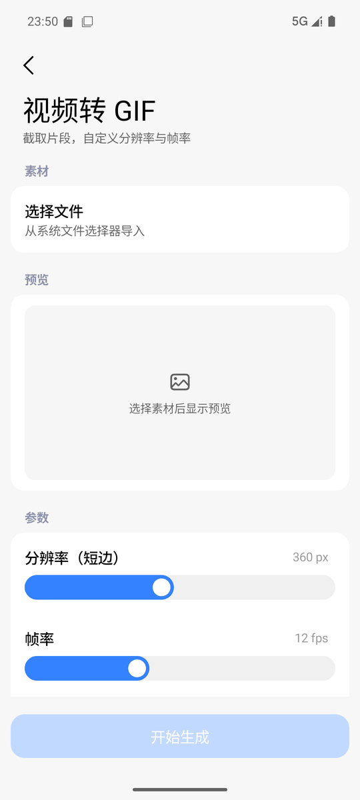
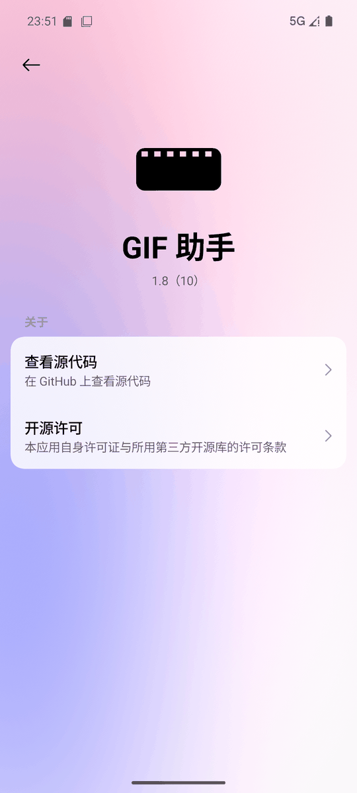
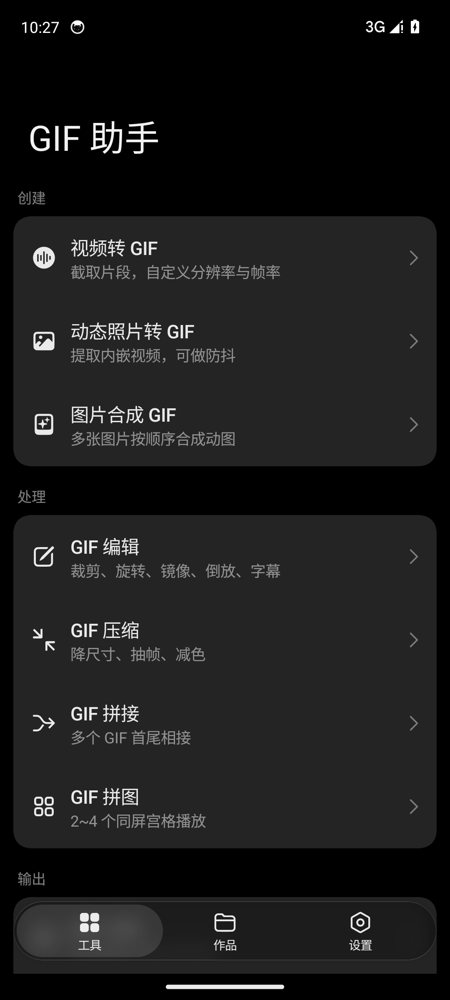
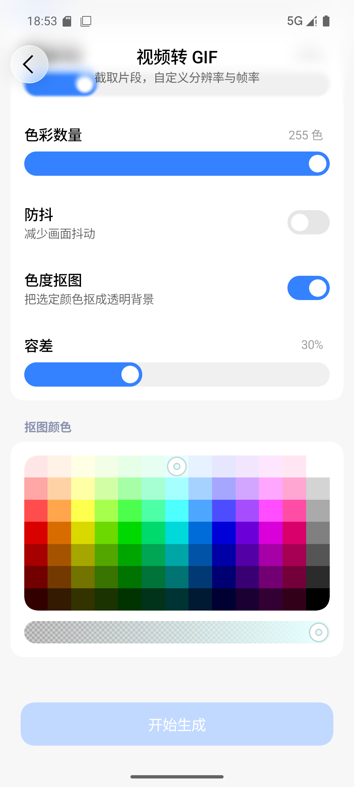

# GIF 助手

纯本地的 Android GIF 工具。转码、编辑、压缩、拼接、拼图、分解共十个功能，全部在设备上跑，
不联网，不要权限（文件走 SAF），也没有广告。

界面是 [Miuix](https://github.com/compose-miuix-ui/miuix)（MIUI / HyperOS 风格的 Compose 组件库）搭的。
静态配色和 Monet 动态取色都有，明暗双模式，底栏是 OS4 那种玻璃。

最新版本 1.14，Android 13 及以上：[Releases](https://github.com/Ayang233/gif-toolkit/releases)

要改代码先看 [AGENTS.md](AGENTS.md)：目录地图、常用命令，还有十几条硬约束
（玻璃录制层怎么摆、三种页面底色怎么分、图标尺寸从哪取）。
路线图和变更记录在 [ROADMAP.md](ROADMAP.md)、[CHANGELOG.md](CHANGELOG.md)。

| 主页 | 工具页 | 设置 | 关于 |
| --- | --- | --- | --- |
|  |  |  |  |

截图是 1.14 拍的。关于页的图标、名称和卡片是拿 `textureBlur` 采样背景渐变画的，需要硬件 GPU，
模拟器得用 `-gpu host` 启动才看得到；软件渲染下这几块会退成实色。

<details>
<summary>深色模式</summary>



</details>

<details>
<summary>色度抠图的调色板</summary>



</details>

## 功能

| 分组 | 功能 | 做什么 |
| --- | --- | --- |
| 创建 | 视频转 GIF | 截片段，调分辨率、帧率、色数，能防抖，色度抠图的颜色从调色板里挑 |
| 创建 | 动态照片转 GIF | 把 Motion Photo（MVIMG）里的内嵌视频抽出来再转 |
| 创建 | 图片合成 GIF | 多张图按顺序合成，帧间隔可调 |
| 处理 | GIF 编辑 | 旋转、镜像、翻转、倒放、居中裁剪、字幕、去水印 |
| 处理 | GIF 压缩 | 降尺寸、抽帧、减色 |
| 处理 | GIF 拼接 | 首尾相接，尺寸不同会自动等比居中 |
| 处理 | GIF 拼图 | 2~4 个 GIF 拼成宫格同步播，列数可选 |
| 输出 | GIF 分解 | 逐帧导出 PNG，打包成 zip |
| 输出 | GIF 转视频 | 导出 MP4 |
| 输出 | GIF 播放 | 调速播放、逐帧翻 |

## 技术栈

- Kotlin Multiplatform，单模块，实现全在 `androidMain`；Compose Multiplatform 1.13.0-rc01
- Miuix 提供全部组件（`miuix-ui` / `-preference` / `-icons` / `-glass` / `-glass-icons` / `-nav` / `-material` / `-squircle`），基线钉在 `b00169ba`（0.9.5-beta03 之后又走了 19 个提交）
- AGP 9.5.2 / Kotlin 2.4.21 / JDK 21 / minSdk 33 / targetSdk 36
- GIF 编解码是纯 Kotlin 写的；取帧和 MP4 编码用系统的 `MediaMetadataRetriever`、`MediaCodec`

## 构建

需要 JDK 21，Android SDK Platform **37.2**（目录名就是 `platforms/android-37.2`，只装 37.0 会在配置期
报 `requires compile against version 37.2 or later`），以及 Build-Tools 37.0.0。shell 用 Git Bash、zsh、bash 都行。

```bash
git clone https://github.com/Ayang233/gif-toolkit.git
cd gif-toolkit

# Miuix 的 glass 模块没发布到 Maven Central，得准备一份源码在同级目录
./scripts/setup-miuix.sh

./gradlew :assembleDebug      # 调试包
./gradlew :assembleRelease    # 发布包，R8 + 资源压缩
```

`setup-miuix.sh` 把 Miuix 克隆到 `../miuix`，切到脚本里钉住的提交，再打一处上游补丁：
Miuix 的 `build-logic` 在配置阶段调 git 取版本号，而 composite build 里子构建的工作目录是宿主工程
（不是 git 仓库），不打这个补丁直接 exit 128。脚本可以重复跑，打过就跳过。

跑完会校验三件事，有一项不过就别急着构建：

| 检查什么 | 不过时的表现 |
|---|---|
| 源码是不是真停在钉住的提交上 | `exit 2`（解析不到这个 ref）或 `exit 3`（停在别的提交）。受限网络下确实要用手头这份，设 `MIUIX_OFFLINE=1` 显式跳过 |
| `workingDir = rootDir` 补丁在不在 | `exit 1`，并打印要手工补的两行 |
| 宿主 AGP 和上游 `gradle/libs.versions.toml` 的 `agp` 是否同版本 | 只告警，但会把两个版本号摆出来，告诉你该改哪一行 |

最后这条不是洁癖：composite build 里两个构建用不同 AGP 会直接失败，报错还挂在
`Using multiple versions of the Android Gradle plugin (9.5.2, 9.5.1)` 上，看着像依赖坏了。

不想用脚本也行：手动克隆后给 `miuix/build-logic/src/main/kotlin/BuildConfig.kt` 的
`getGitVersionCode()` 和 `getGitHashShort()` 各加一行 `workingDir = rootDir`。
也可以用环境变量 `MIUIX_DIR` 指到别的 miuix 目录。

SDK 路径写进 `local.properties`（`sdk.dir=/path/to/Android/Sdk`），或者只设 `ANDROID_HOME`，两种都验证过。

release 用的是 debug 签名，图个装机方便。真要分发请换成自己的 keystore。

## 目录结构

```
src/androidMain/kotlin/com/ayang/giftoolkit/
├── App.kt                 主题、NavDisplay 路由、一级页（Pager + 玻璃底栏）、宽屏侧栏、弹层宿主
├── Route.kt               路由（Root / Tool / About / Licenses / License）
├── AppState.kt            全局状态，每个工具一份 ToolForm
├── MainActivity.kt        edge-to-edge 入口
├── data/SettingsStore.kt  外观设置的持久层（SharedPreferences）
├── ui/
│   ├── ToolCatalog.kt     十个工具的元数据与图标
│   ├── Widgets.kt         分组卡片、行、下拉、预览舞台、主操作条、三层配色推导
│   ├── PageChrome.kt      页面骨架 Os4ListPage、内边距、滚动修饰符
│   ├── GlassScope.kt      页面玻璃作用域、顶栏、录制层
│   ├── GlassSupport.kt    玻璃开关与能力检测（唯一决策点）
│   ├── Adaptive.kt        宽屏判定与侧栏让位
│   ├── ProgressButton.kt  带进度填充的按钮（移植，Apache-2.0）
│   ├── bg/                关于页的 OS3 动态渐变背景（移植自 miuix 示例）
│   └── LicenseCatalog.kt  第三方组件清单
├── screens/               主页 / 工具页 / 作品页 / 设置 / 关于 / 开源许可
├── task/TaskRunner.kt     任务执行与预览取帧
└── core/                  GifCodec / MediaTools / GifTasks / Stabilizer / ColorKey / MotionPhoto
```

## 改 UI 前先看这几条

完整的在 [AGENTS.md](AGENTS.md)，这里挑最容易踩的：

1. 玻璃容器必须是 `layerBackdrop` 录制层的兄弟节点，不能是它的子节点，录制层也不能上移到 `Scaffold`。
   否则玻璃采到自己，`libhwui` 的 `RenderNode::prepareTreeImpl` 会递归到栈溢出，直接闪退。
   弹层的采样源还得录在 `HorizontalPager` 外面：Pager 的页面按页宽错位，页面内录制层上报的是槽位坐标，
   跟弹层的真实坐标差一整页宽，采样整块落空，玻璃就只剩材质。
2. 颜色分三层，别混。`pageBaseColor()` 是页面真正铺在屏幕上的那层（`surface`），
   玻璃录制层垫底、底部主操作条遮挡、页面 `containerColor` 只用它；`pageColor()` 是从卡片色反推的
   次级表面，给预览舞台这种要拉开一档的位置；`cardColor()` 才是卡片。写错的症状很具体：
   深色下拿 `pageColor()` 当页面底色，页面上会多出一条比页面亮三十个灰阶的带子。
   「Monet 会把 surface 和 surfaceContainer 压成同一个值」这个旧结论，在现在的 Miuix 上已经不成立。
3. `GlassDialog` / `GlassBottomSheet` 要有 Scaffold 当宿主。`App.kt` 最外层那个
   `Scaffold(containerColor = Transparent, contentWindowInsets = 0)` 就是干这个的，去掉它们会静默不渲染。
   页面级弹层走 `Os4ListPage` 的 `pageOverlay` 槽位（在 Scaffold 里、录制层外）。
4. 卡片里不放分割线，靠 56dp 最小行高和 16dp 内边距区分。
5. 宽屏判定（840 / 600 / 1200）和预览区高度上限都读 `LocalContainerSize`，由 `App.kt` 根部
   `BoxWithConstraints` 注入。别再各处直接读 `LocalWindowInfo`：多窗口和分屏下"窗口多大"
   和"这棵 UI 实际有多少可用区域"不是一回事。
6. 不引入 `androidx.compose.material3`。设计语言会打架，包体也明显变大。

## 已知限制

- 「去水印」是按区域打马赛克，不是真正的 inpainting
- 取帧还是逐帧 `getFrameAtTime`，长视频偏慢，计划换成 `MediaCodec` 顺序解码
- 没有目标体积压缩，不会为了压到某个大小自动二分色数或帧率
- 进程被杀后返回栈能恢复，但页面里的选择（素材、参数、进度）会丢
- 玻璃在低端机上的性能没充分验证，设置里可以关掉
- 关于页的图标和名称用原生 `textureBlur` 采样背景画，需要硬件 GPU。模拟器请用 `-gpu host`，
  `-gpu swiftshader_indirect` 这种软件光栅化不产出模糊像素，在那儿看到的异常是渲染器的问题

## 许可证

[GNU General Public License v3.0](LICENSE)。1.0 及更早的版本按 Apache-2.0 发布，已经发出去的副本不受影响。
第三方组件和致谢在 [NOTICE](NOTICE)，应用内「设置 → 关于 → 开源许可」里也能看到完整文本。
