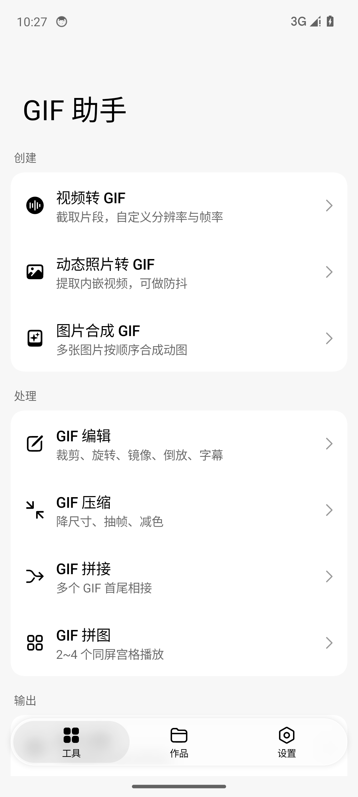
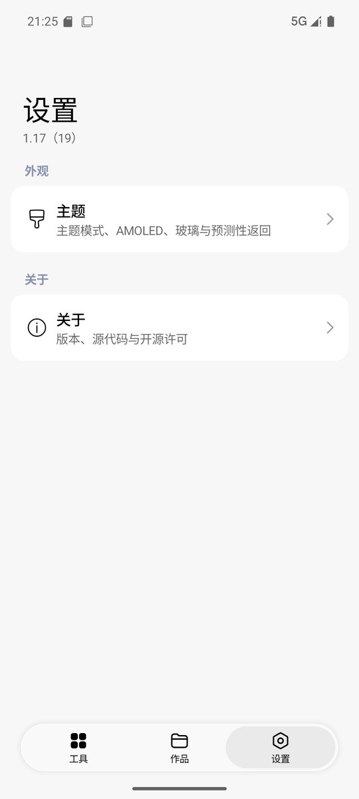

# GIF 助手

纯本地的 Android GIF 工具集：转码、编辑、压缩、拼接、拼图、分解，十个功能都在设备上完成，
不联网、不申请业务权限（文件通过 SAF 访问）、无广告。

界面基于 [Miuix](https://github.com/compose-miuix-ui/miuix)（MIUI / HyperOS 风格的 Compose 组件库）重写，
支持静态配色与 Monet 动态取色两套主题、明暗双模式，以及 OS4 玻璃质感的浮动底栏。

**下载**：[Releases](https://github.com/Ayang233/gif-toolkit/releases)（Android 13 及以上，当前 1.11）

文档：[开发须知 AGENTS.md](AGENTS.md) · [路线图 ROADMAP.md](ROADMAP.md) · [变更记录 CHANGELOG.md](CHANGELOG.md)

> 改这个项目之前请先读 [AGENTS.md](AGENTS.md)：目录地图、常用命令，以及 15 条硬约束
> （玻璃录制层、配色推导、图标规范、Scaffold 宿主、状态栏适配等）。

| 主页 | 工具页 | 设置 | 关于 |
| --- | --- | --- | --- |
|  |  |  |  |

> 截图取自 1.8。「关于」页这一张是**关闭玻璃材质**时的样子 —— 开启玻璃时图标、软件名称与卡片
> 由 `textureBlur` 采样背景渐变绘制（需要硬件 GPU；模拟器请用 `-gpu host` 启动）。

<details>
<summary>深色模式</summary>


</details>

## 功能

| 分组 | 功能 | 说明 |
| --- | --- | --- |
| 创建 | 视频转 GIF | 截取片段，自定义分辨率、帧率、色彩数量，可防抖、可色度抠图 |
| 创建 | 动态照片转 GIF | 从 Motion Photo（MVIMG）中提取内嵌视频再转 GIF |
| 创建 | 图片合成 GIF | 多张图片按顺序合成，自定义帧间隔 |
| 处理 | GIF 编辑 | 旋转、镜像、翻转、倒放、居中裁剪、字幕、去水印 |
| 处理 | GIF 压缩 | 降尺寸、抽帧、减色 |
| 处理 | GIF 拼接 | 多个 GIF 首尾相接，尺寸不同自动等比居中 |
| 处理 | GIF 拼图 | 2~4 个 GIF 拼成宫格同步播放，列数可选 |
| 输出 | GIF 分解 | 逐帧导出 PNG 并打包为 zip |
| 输出 | GIF 转视频 | 导出为 MP4 |
| 输出 | GIF 播放 | 调速播放与逐帧浏览 |

## 技术栈

- Kotlin Multiplatform（单模块，`androidMain` 承载全部实现）+ Compose Multiplatform 1.12.2
- [Miuix](https://github.com/compose-miuix-ui/miuix) 提供全部 UI 组件（`miuix-ui` / `-preference` / `-icons` / `-glass` / `-glass-icons` / `-nav` / `-material` / `-squircle`）
- AGP 9.5.1 / Kotlin 2.4.21 / JDK 21 / minSdk 33 / targetSdk 36
- GIF 编解码为纯 Kotlin 实现，视频取帧与 MP4 编码使用系统 `MediaMetadataRetriever` / `MediaCodec`

## 构建

### 前置

- JDK 21
- Android SDK Platform 37、Build-Tools 37.0.0
- 一把能跑 `gradlew` 的 shell（Git Bash / zsh / bash 均可）

SDK 路径可以写进 `local.properties`（`sdk.dir=/path/to/Android/Sdk`），也可以只设 `ANDROID_HOME` 环境变量——
两种方式都验证过。

### 步骤

```bash
git clone https://github.com/Ayang233/gif-toolkit.git
cd gif-toolkit

# Miuix 没有把 glass 模块发布到 Maven Central，必须准备一份源码在同级目录
./scripts/setup-miuix.sh

./gradlew :assembleDebug      # 调试包
./gradlew :assembleRelease    # 发布包（R8 + 资源压缩）
```

`scripts/setup-miuix.sh` 会克隆 Miuix 到 `../miuix`（与工程同级），切到开发时验证过的提交，
并打上 composite build 必需的一处上游补丁——Miuix 的 `build-logic` 在配置阶段调用 git 取版本号，
而子构建的工作目录是宿主工程（不是 git 仓库），不打补丁会直接 exit 128。
脚本可重复执行，已打过会跳过。

没准备 Miuix 时，Gradle 同步会直接给出带克隆命令的报错，不会只丢一句「找不到项目」。

不想用脚本的话，手动克隆后给
`miuix/build-logic/src/main/kotlin/BuildConfig.kt` 里的 `getGitVersionCode()` 和 `getGitHashShort()`
各加一行 `workingDir = rootDir` 即可。也可以用环境变量 `MIUIX_DIR` 指定别的路径。

### 关于 release 签名

`build.gradle.kts` 里 release 用的是 debug 签名，方便直接装机试用。要正式分发请换成自己的 keystore。

## 目录结构

```
src/androidMain/kotlin/com/ayang/giftoolkit/
├── App.kt                 主题、NavDisplay 路由、一级页（Pager + 玻璃底栏）、宽屏侧栏、弹层宿主
├── Route.kt               路由（Root / Tool / About / Licenses / License）
├── AppState.kt            全局状态 + 每个工具一份 ToolForm
├── MainActivity.kt        edge-to-edge 入口
├── data/SettingsStore.kt  外观设置的持久层（SharedPreferences）
├── ui/
│   ├── ToolCatalog.kt     十个工具的元数据与图标
│   ├── Widgets.kt         分组卡片、行、下拉、预览舞台、主操作条、三层配色推导
│   ├── PageChrome.kt      页面骨架 Os4ListPage / 内边距 / 滚动修饰符
│   ├── GlassScope.kt      页面玻璃作用域、顶栏、录制层
│   ├── GlassSupport.kt    玻璃开关与能力检测（唯一决策点）
│   ├── Adaptive.kt        宽屏判定与侧栏让位
│   ├── ProgressButton.kt  带进度填充的按钮（移植，Apache-2.0）
│   ├── bg/                关于页的 OS3 动态渐变背景（移植自 miuix 示例）
│   └── LicenseCatalog.kt  第三方组件清单
├── screens/               主页 / 工具页 / 作品页 / 设置 / 关于 / 开源许可
├── task/TaskRunner.kt     任务执行与预览取帧
└── core/                  GifCodec / MediaTools / GifTasks / Stabilizer / ColorKey / MotionPhoto
```

## 设计约束（改 UI 前值得先看）

几条踩过的坑，完整清单见 [AGENTS.md](AGENTS.md)：

1. **玻璃容器必须是 `layerBackdrop` 录制层的兄弟节点，不能是子节点，录制层也不能上移到 `Scaffold`。**
   否则玻璃会采样到自己，`libhwui` 的 `RenderNode::prepareTreeImpl` 递归到栈溢出、直接闪退。
   另外，弹层的采样源必须录在 `HorizontalPager` **外面**：Pager 的页面按页宽错位，
   页面内录制层上报的是槽位坐标，和弹层的真实坐标差一整页宽，采样会整块落空。
2. **颜色分三层，别混用。** `pageBaseColor()` 是页面真正铺在屏幕上的那层（`surface`），
   玻璃录制层垫底色、底部主操作条遮挡、页面 `containerColor` 只用它；
   `pageColor()` 是由卡片色反推的**次级表面**（比页面深/浅一档），给预览舞台这类要拉开层次的位置；
   `cardColor()` 才是卡片。写错会露馅：深色下把 `pageColor()` 当页面底色，
   页面上会出现一条比页面亮 30 个灰阶的色带（第十轮实测）。
   旧结论「Monet 会把 `surface` / `surfaceContainer` 压成同一个值」在当前 Miuix 上已不成立，
   四套配色实测都不同值。
3. **`GlassDialog` / `GlassBottomSheet` 需要 Scaffold 作为宿主。** `App.kt` 顶部那层
   `Scaffold(containerColor = Transparent, contentWindowInsets = 0)` 就是弹层宿主（官方 `GlassPageHost` 同款），
   去掉它这类组件会静默不渲染；页面级弹层走 `Os4ListPage` 的 `pageOverlay` 槽位（Scaffold 内、录制层外）。
4. **Miuix 卡片内不放分割线**，靠 56dp 最小行高与 16dp 内边距区分。
5. **不引入 `androidx.compose.material3`**，会和 Miuix 的设计语言打架，也明显增大包体。

## 已知限制

- 「去水印」目前是按区域打马赛克，不是真正的 inpainting
- 视频取帧仍是逐帧 `getFrameAtTime`，长视频偏慢，计划换成 `MediaCodec` 顺序解码
- 没有目标体积压缩（不会为了压到某个大小自动二分色数/帧率）
- 进程被杀后返回栈能由系统恢复到原页面，但页面里的选择（已选素材、参数、生成进度）会丢
- 玻璃在低端机上的性能未充分验证，设置里可关闭
- 关于页的图标与软件名称用原生 `textureBlur` 采样背景绘制，需要硬件 GPU。
  模拟器请用 `-gpu host` 启动（与真机一致）；`-gpu swiftshader_indirect` 这类软件光栅化环境
  不产出模糊像素，不是可信的观感环境，看到异常属渲染器问题。

## 许可证

[GNU General Public License v3.0](LICENSE)。1.0 及更早的版本按 Apache-2.0 发布，已发出的副本不受本次变更影响。第三方组件与致谢见 [NOTICE](NOTICE)，
应用内「设置 → 关于 → 开源许可」也可以查看完整许可文本。
