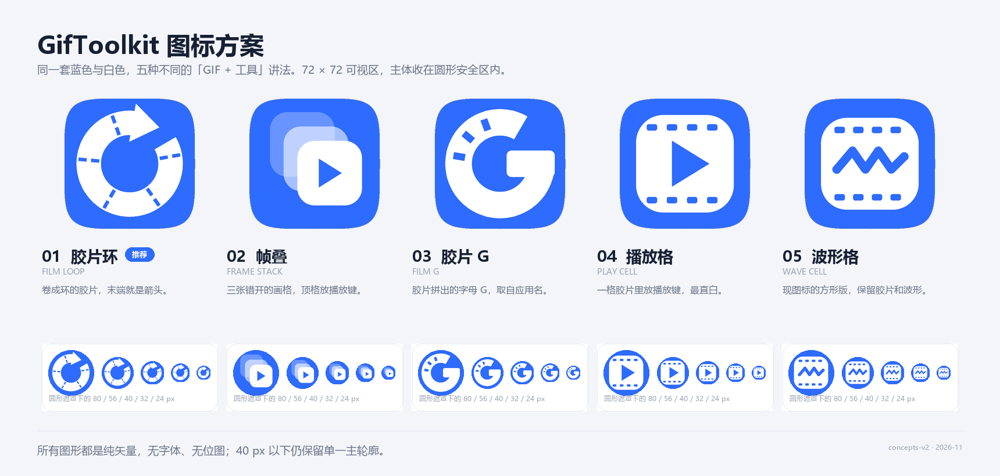

# GifToolkit 图标方案 v2

五个矢量方向，同一套蓝色（`#2E6BFF`）与白色。所有图形都是手写的纯几何路径，没有字体、位图或外部素材。

预览按 Android 自适应图标的 **72 × 72 可视区**裁切：系统真正会显示的是 108 层中间的那 72，主体已经收进半径 36 的圆形安全区，装上桌面不会被圆形 / 方形遮罩切掉。SVG 与 PNG 是同一份几何数据生成的。



## 五个方向

| # | 方案 | 在说什么 | 缩到 40 px 时 |
| --- | --- | --- | --- |
| 01 | 胶片环 / Film Loop | 一条胶片卷成环，末端就是箭头；循环和胶片是同一个形。 | 齿孔退成虚线，留下一个很清楚的循环箭头。 |
| 02 | 帧叠 / Frame Stack | 三张错开的画格，最上面一张是播放键；更像“作品 / 帧序列”。 | 仍然是一叠卡片加播放键，最安静的一版。 |
| 03 | 胶片 G / Film G | 胶片拼出的字母 G，直接从应用名起手，做品牌字标。 | G 的轮廓还认得出来，齿孔变成肩上的碎点。 |
| 04 | 播放格 / Play Cell | 一格胶片里放播放键，最直白的一版。 | 播放键最稳，但最接近通用播放器。 |
| 05 | 波形格 / Wave Cell | 现图标（胶片条 + 波形）的方形版，保留原来的识别点。 | 波形仍然清楚，变化最小。 |

## 我的建议

- **主图标选 01。** 它同时有“循环”和“胶片”，不是普通的刷新箭头；大尺寸能看出齿孔，小尺寸又收得回一个干净的主轮廓。和现有图标相比是真正换了一套形，不是换色。
- 如果更在意“像系统自带、绝对不出错”，选 **04**；代价是会被当成视频播放器。
- 如果想把 GifToolkit 做成一个能长期用的名字，选 **03**；字母标比图形标更容易沉淀。
- **05** 只适合“不想大改”的情况，它基本是现图标的方形重排。

## 文件

```
01_film_loop.svg / .png
02_frame_stack.svg / .png
03_film_g.svg / .png
04_play_cell.svg / .png
05_wave_cell.svg / .png
overview.png      五种方案 + 圆形遮罩尺寸阶梯
desktop.png       48 dp 桌面观感（示意）
```

SVG 的 `viewBox` 是 `0 0 72 72`，对应系统可视区；PNG 是 512 × 512。要落成 Android 自适应图标时，把同一份几何放回 108 层、加 18 的边距即可。

## 还没做的事

这次只出方案，没有改 `src/androidMain/res/`。选定后需要一起处理：

1. `ic_launcher_foreground.xml`（108 层，主体按安全区缩放）
2. `ic_launcher_monochrome.xml`（主题图标，去掉齿孔等细节，保一个干净剪影）
3. `ic_app_mark.xml` / `ic_app_badge.xml`（关于页与徽章，跟桌面图标同一套形）
4. `colors.xml` 的图标底色，以及圆形 / 方形遮罩下的小尺寸实机确认

概念 SVG 里的齿孔是用底色画上去的（背景是平的，效果与挖空一致）；真正做自适应前景时，会改成 `evenOdd` 挖空或独立透明路径，不能直接把这层当透明前景用。
