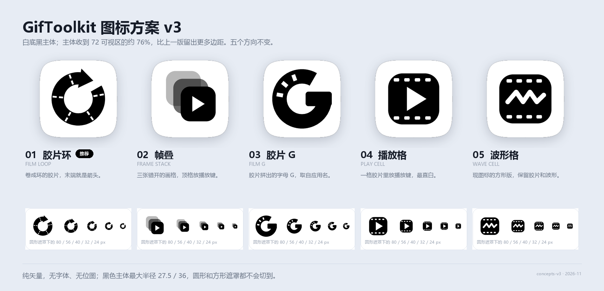

# GifToolkit 图标方案 v3

> 已选定 **01 胶片环**，1.17 起落地为白底黑主体的自适应图标；关于页也换成同一张普通静态图标。

按你的要求改的：**白底、黑主体、主体收小**。五个方向还是 v2 那五个，只换配色和尺寸。



## 这次改了什么

- 底色 `#FFFFFF`，主体 `#000000`；齿孔、播放键、波形这些“挖空”位置回到白色。
- 主体最大半径统一收到 **27.5**（72 可视区、半径 36 的圆形安全区），四周至少留 8.5 的边。
  对照 v2 的 30–33，整体明显收了一圈，但还不至于缩成一个小图章。
- 02 帧叠的两层背板是黑色加透明度，所以在白底上呈灰阶，不影响“一叠画格”的层次。

## 五个方向

| # | 方案 | 一句 |
| --- | --- | --- |
| 01 | 胶片环 / Film Loop | 胶片卷成环，末端是箭头；推荐。 |
| 02 | 帧叠 / Frame Stack | 三张错开画格，顶格放播放键；最安静。 |
| 03 | 胶片 G / Film G | 胶片拼出的 G，做品牌字标。 |
| 04 | 播放格 / Play Cell | 一格胶片里放播放键；最直白、最稳。 |
| 05 | 波形格 / Wave Cell | 现图标的方形版，保留胶片和波形。 |

## 尺寸说明

预览按 Android 自适应图标的 72 × 72 可视区裁切，不是 108 整层。系统真正显示的是中间 72，黑色主体的最大半径 27.5 / 36，所以圆形、方形遮罩都不会切到边缘。SVG 的 `viewBox` 也是 `0 0 72 72`，和 PNG 完全同源。

如果还想再小一点，可以把目标半径降到 25（再收 9%）；想再大一点可以回到 29。现在这档是“正常尺寸”，不是上一版那种顶满的效果。

## 文件

```
01_film_loop.svg / .png
02_frame_stack.svg / .png
03_film_g.svg / .png
04_play_cell.svg / .png
05_wave_cell.svg / .png
overview.png      五种方案 + 圆形遮罩尺寸阶梯
desktop.png       深色桌面 48 dp 观感
```

仍然没有改 `src/androidMain/res/`。选定后需要落自适应图标的前景层、单色层、关于页 mark，并做 40 px 与圆形遮罩实机确认。概念 SVG 的齿孔是用白色画在黑色主体上的（背景是平的，效果等同挖空）；真正做透明前景时会改成 `evenOdd` 挖空。
